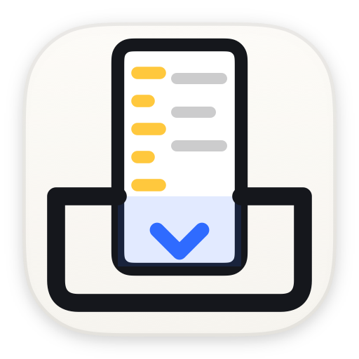
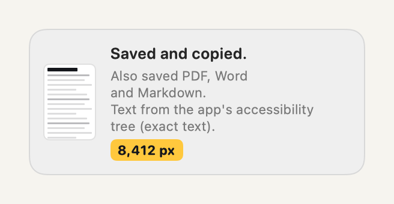
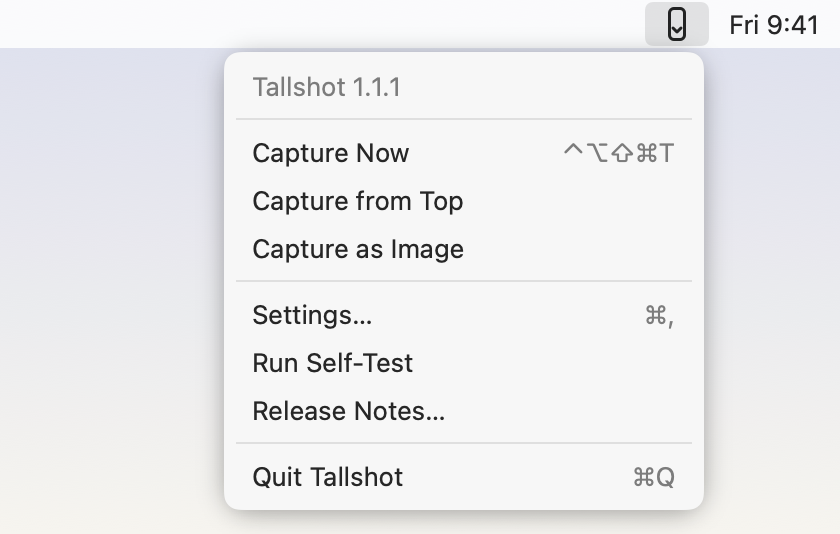
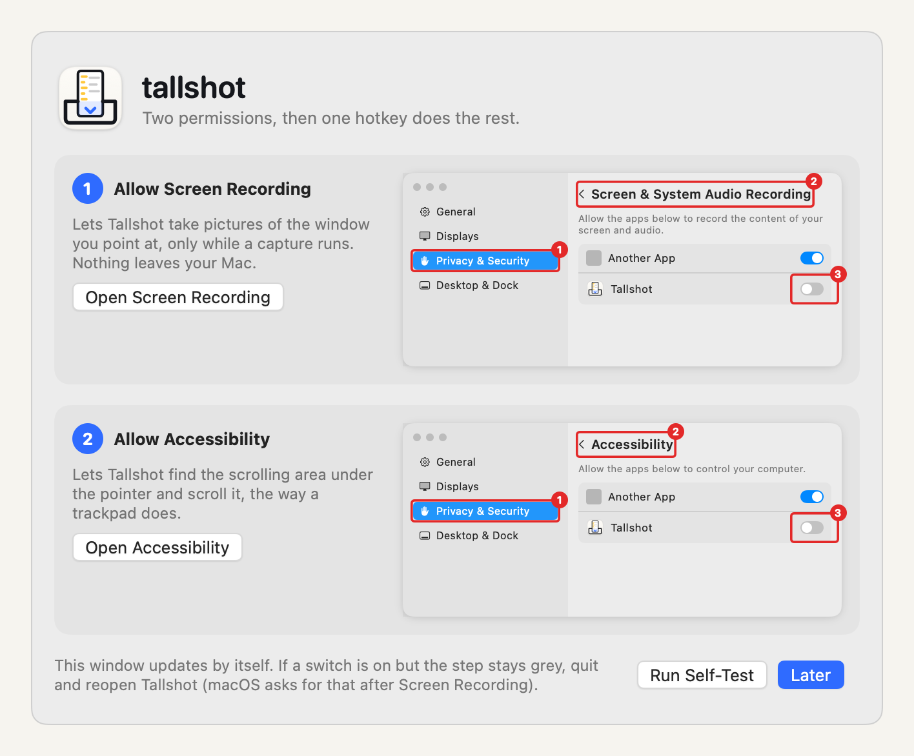

<p align="center"></p>

<h1 align="center">tallshot</h1>

<p align="center"><b>One hotkey. The whole page.</b><br>Scrolling screenshots on Mac without drawing a box.</p>

Tallshot is a free, open-source Mac menu bar app that turns any scrolling window into one tall screenshot. Point at what you want, press the keys, and it scrolls from where you are to the bottom, stitches the pieces, saves the PNG to your Desktop and copies it to your clipboard. No box to draw, no editor to close.

**Website:** https://garoknows.github.io/tallshot/

## How it works

1. **Point** the mouse at what you want: a web page, a chat thread, one pane of a split window, a Finder list. Tallshot captures just that pane: no app sidebar, no browser toolbar.
2. **Press** <kbd>⌃⌥⇧⌘T</kbd> (Control, Option, Shift, Command and T). A thin blue outline flashes around exactly the pane Tallshot picked, before anything scrolls. If it's the wrong one, press Esc.
3. **Paste.** Tallshot scrolls to the bottom, waits for each step to settle, and stitches the strips. The PNG lands on your Desktop and on your clipboard, and a small preview pop-up shows the height. Click the pop-up to open the file.

<p align="center"></p>

- **Sticky headers and chat input boxes appear once**, not on every strip. Tallshot spots the parts that never move and leaves them out of the line-up.
- **It starts where you are.** To get the whole thing, use **Capture from Top** in the menu (you can give it its own hotkey in Settings).
- **Terminals and documents: just the text.** When the pane is a terminal (Ghostty, Terminal), Notes, TextEdit or a code editor that shares all its text with macOS, Tallshot copies that text as Markdown and saves it (plus PDF and Word if those are on), with no scrolling and no pictures. It does this only when the app shows its text is complete, scrolled-away part included. Browsers and chat apps share only what's on screen, so they always get a scrolling screenshot. **Capture as Image** in the menu (it can have its own hotkey) always takes the screenshot, and Settings → General → When an app shares its text → Always take a scrolling screenshot turns text captures off. The pop-up says which one ran.
- **Stop any time:** press Esc, or touch the mouse or keyboard. Tallshot keeps what it captured so far.
- **Very long pages** stop at 30,000 pixels tall or 60 seconds (both adjustable). Very wide captures also stop at 50 million pixels in all, to keep memory use well under 1 GB.
- **Browsers and chat apps.** In Chrome, Arc, Safari and Electron apps Tallshot finds the pane you point at, leaves out the browser's toolbar and the app's sidebar, and handles the floating buttons and message box of chat apps. **Capture from Top** waits for older messages to load, so you can export a whole chat.
- **Also save as PDF, Word and Markdown.** The PDF is the tall image on Letter or A4 pages, cut between lines of text, and searchable. Word and Markdown get the words with their headings, nested bullets, links and code blocks: read from the app when it shares them, otherwise recognized from the image on your Mac. You can also copy the text as Markdown instead of the image.
- **File names that say what's in them.** For example `Arc - example.com - Chat test - 2026-11-07 at 14.05 - Tallshot.png`: the app, the site's domain in a browser, the window or page title, the date and time. Nothing goes in from a password field that has the keyboard or a Chrome Incognito window. The title and domain go only in the file names, not inside the files (the PDF's title is just "Tallshot capture"); the one exception is the Markdown file's link to the PNG beside it. Settings → Output → File names → Date only gives `2026-11-07 at 14.05.22 - Tallshot.png`.
- **It measures every step.** If an app scrolls further than asked, Tallshot asks for less and walks back until the pictures overlap again. If a capture stops early, the pop-up says so and why.

<p align="center"></p>

### From Raycast, Shortcuts or a script

```
open tallshot://capture
open "tallshot://capture?from=top"
open "tallshot://capture?as=image"
```

## Install

1. Download the latest `.dmg` from [Releases](https://github.com/garoknows/tallshot/releases).
2. Open it and drag **Tallshot** to Applications.
3. Open Tallshot. It lives in the menu bar (no Dock icon). See [docs/INSTALL.md](docs/INSTALL.md) if macOS says it can't check the app.

Or build it yourself (needs Xcode): `git clone https://github.com/garoknows/tallshot && cd tallshot && scripts/install.sh`

## Permissions

Tallshot asks for two permissions the first time it opens, with a window that shows exactly where to click:

| Permission | Why |
| --- | --- |
| **Screen Recording** | To take pictures of the window you point at, only while a capture runs. |
| **Accessibility** | To find the scrolling area under the pointer and scroll it, the way a trackpad does. |

<p align="center"></p>

When both steps are green, click **Run Self-Test**. Tallshot opens a test page and captures it for real, then checks that every one of its 2,400 numbered rows came out once, in order. You can also point at the test page and press the hotkey.

To test a browser, open the [chat test page](https://garoknows.github.io/tallshot/test/chat/), point at the chat and press the hotkey. Its rows are barcoded too, so the pop-up says whether the capture came out right.

## Privacy

Tallshot can see the screen and send scroll events, so these rules matter. Each one is checked by a test or by macOS, not just promised. More detail in [docs/PRIVACY.md](docs/PRIVACY.md).

- **No network.** There is no networking code and no third-party code in the app. A check in CI scans the source and the built app on every push.
- **Captures go only where you send them:** your clipboard and the folder you chose. Frames are held in memory during a capture and never written to temp files, caches or logs. PDF, Word and Markdown are built in memory and written straight into that folder.
- **Text captures read only the pane you point at.** When an app shares its whole text, Tallshot reads that one text element through Accessibility, when you press the hotkey, and puts it only on your clipboard and in your folder, like any capture.
- **Text recognition happens on your Mac** (Apple's Vision framework). No text or image is sent anywhere.
- **Captures only when you ask.** Nothing runs in the background. The screen is read only between the hotkey and the end of that capture.
- **Protected windows stay protected.** Windows macOS marks as private are left as macOS returns them.
- **No analytics, no crash reporting, no account.** Settings are the only thing stored.
- **Diagnostics only if you ask.** An optional setting (off by default) saves a report folder when a capture stops early, next to the capture or in a folder you choose, for you to share if you want. Nothing is ever sent.

## Build and test

```
swift test -c release --package-path Packages/TallshotCore   # stitching engine + offscreen AppKit harness
scripts/install.sh                                # build with Xcode, install to ~/Applications
scripts/check-privacy.sh path/to/Tallshot.app     # the privacy checks CI runs
```

`Packages/TallshotCore` is the stitching engine: pure Swift, no UI and no system calls, tested on generated pages with numbered, barcoded rows (sticky headers, footers, sidebars, scroll jitter, animations, pages that grow). The harness test scrolls a real `NSScrollView` offscreen and checks the result equals the full render pixel for pixel.

## License

MIT. See [LICENSE](LICENSE).
