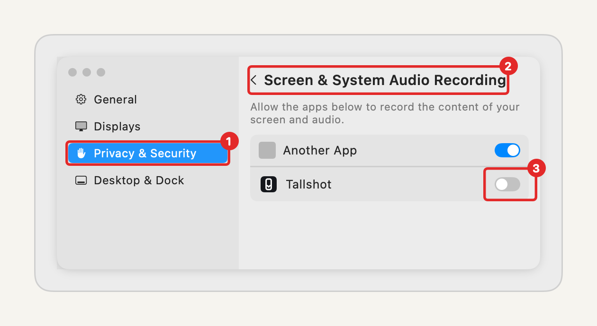
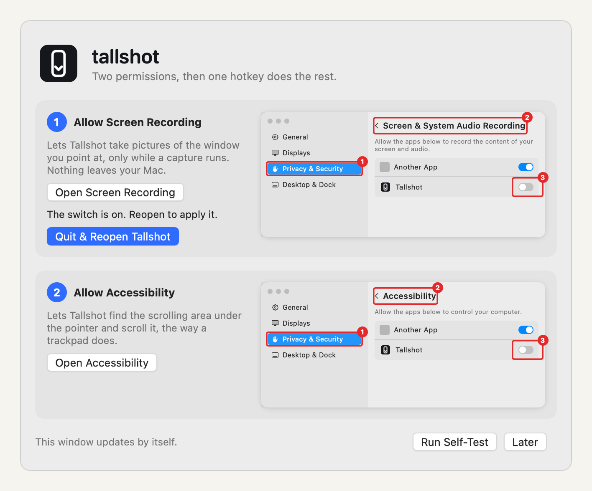
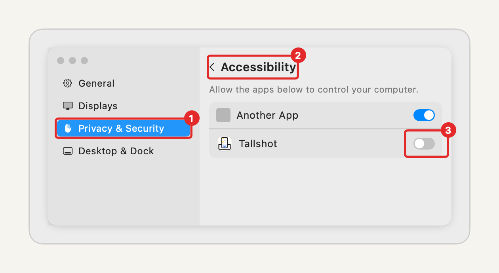

# Installing Tallshot

## From the download

1. Download `Tallshot-<version>.dmg` from [Releases](https://github.com/garoknows/tallshot/releases).
2. Open the .dmg and drag **Tallshot** onto **Applications**.
3. Open Tallshot from Applications. It appears in the menu bar as a tall, narrow rounded icon. There's no Dock icon.

### If macOS says it can't check Tallshot

Early previews may not be signed and notarized by Apple yet. If macOS says *"Tallshot" can't be opened because Apple cannot check it for malicious software*:

1. Click **Done** (not Move to Trash).
2. Open **System Settings → Privacy & Security**.
3. Scroll down to the message about Tallshot and click **Open Anyway**.
4. Confirm with your password or Touch ID, then click **Open**.

You only do this once. Signed and notarized releases open with no warning.

## The two permissions

On first launch, Tallshot shows a setup window with pictures of exactly where to click.



1. Click **Open Screen Recording**. In System Settings, turn on the switch next to **Tallshot**. macOS may ask you to quit and reopen Tallshot; do that with the **Quit & Reopen Tallshot** button, which appears in the setup window when the switch is on but Tallshot still reads it as off.





2. Click **Open Accessibility** and turn on the switch next to **Tallshot**.

Each step turns green by itself. Then click **Run Self-Test**: Tallshot captures its own test page and tells you whether every row came out once, in order.

## Using it

- Point at any scrolling area and press **⌃⌥⇧⌘T**.
- **Capture from Top** in the menu scrolls to the top first. From the menu, Tallshot captures the front window; with a hotkey, the window under the pointer.
- Esc, a click, a key or moving the mouse stops it and keeps what was captured.
- Settings (menu → Settings…):
  - **General:** the hotkeys (with a warning under the field if macOS or another app already uses one), Capture (pane under the pointer, or the whole window), Open at login.
  - **Output:** the save folder; Also save as PNG, PDF, Word (.docx), Markdown (.md); Copy as image or text; PDF page size; the preview pop-up; the shutter sound.
  - **Capture:** scroll speed, the height and time limits, and the optional diagnostic report and where it goes.

## Building from source

Needs Xcode (free in the Mac App Store) and, optionally, [XcodeGen](https://github.com/yonaskolb/XcodeGen).

```
git clone https://github.com/garoknows/tallshot
cd tallshot
scripts/install.sh
```

It installs to `~/Applications`. Set `TALLSHOT_DEST=/Applications` to install for all users.

## Uninstalling

Quit Tallshot from its menu, then drag it from Applications to the Trash. To remove its settings too: `defaults delete io.github.garoknows.tallshot`. You can also remove it from the Screen Recording and Accessibility lists in System Settings.
